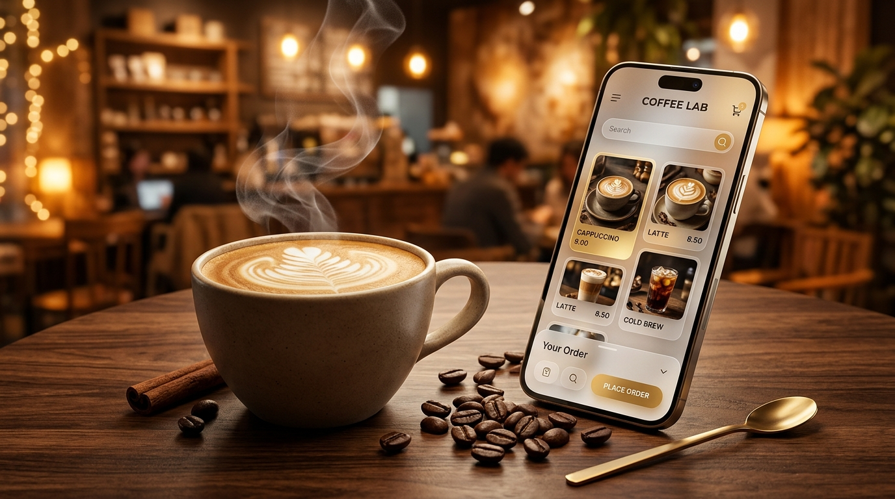

<div align="center">

# ☕ 🥐 CoffeeApp
### *Artisanal Specialty Coffee & Café Lounge* ✨ 🧋

<br/>

<p align="center">
  
</p>

<p align="center">
  <a href="https://kotlinlang.org/"></a>
  <a href="https://firebase.google.com/"></a>
  <a href="#-frosted-glass-glassmorphism-ui"></a>
  <a href="https://developer.android.com/"></a>
</p>

> ☕ *"Life is too short for mediocre coffee. CoffeeApp brings the intoxicating aroma, cozy warmth, and handcrafted perfection of a third-wave specialty roastery straight to your fingertips."* 🪵 🌿 🥞

</div>

---

## 🌟 The Specialty Café Experience

Imagine stepping into your favorite cozy café on a cool morning: the hiss of the steam wand, the rich earthy perfume of freshly ground Arabica beans, and the glow of warm ambient lights. 🕯️ 

**CoffeeApp** translates that sensory journey into an ultra-modern mobile app. It blends a **dark-roast aesthetic** with **frosted glass UI (Glassmorphism)** and real-time cloud data delivery through **Google Firebase**.

---

## 🥐 The 9 Sacred Coffee & Bakery Collections

Every single brew and pastry is synced live from Firebase, organized into 9 handcrafted collections:

| ☕ Hot Coffee | 🧊 Ice Coffee & Cold Brew | ⚗️ Brewing Bar |
| :---: | :---: | :---: |
| Single-origin Espressos, Silky Lattes, Spanish Cortados & velvety Flat Whites. 🤎 | 18-hour cold steeped brews, Iced Americanos & creamy vanilla cold foams. ❄️ | Manual V60 pour-overs, Chemex drip, and precision Aeropress roasts. 🧪 |
| **🍵 Hot Teas & Tonics** | **🧋 Ice Refreshers** | **🥤 Thick Shakes & Frappés** |
| Kyoto Ceremonial Matcha, Spiced Masala Chai & organic soothing herbal teas. 🌿 | Sparkling citrus spritzers, wild berry lemonades & dragonfruit quenchers. 🍓 | Decadent Belgian chocolate, salted caramel & creamy hazelnut shakes. 🍫 |
| **🥐 Morning Bakery** | **🍰 Artisan Patisserie** | **🍽️ Gourmet Lounge Pairings** |
| Flaky French butter croissants, avocado sourdough toast & breakfast bagels. 🥞 | New York baked cheesecakes, espresso tiramisu & fudge brownies. 🎂 | Truffle fries, grilled artisan paninis & chef-curated savory delights. 🥪 |

---

## 💎 Frosted Glass (Glassmorphism) UI

The user interface isn't flat — it uses **hardware-accelerated live background blur** via RenderScript to create the iconic frosted glass café look:

```kotlin
// ☕ Real-time frosted glass effect on the coffee dashboard
val decorView = this.window.decorView
val rootView = decorView.findViewById<View>(android.R.id.content) as ViewGroup

binding.blurView.setupWith(rootView, RenderScriptBlur(this))
    .setFrameClearDrawable(decorView.background)
    .setBlurRadius(10f) // Soft, cozy Gaussian blur radius

binding.blurView.setOutlineProvider(ViewOutlineProvider.BACKGROUND)
binding.blurView.setClipToOutline(true)
```

---

## ☁️ Realtime Cloud Roastery Pipeline (Firebase + MVVM)

```text
       ☁️ Google Firebase Realtime Database
                   ("Items" Catalog)
                           │
                           ▼
       ⚡ MainRepository.kt (Realtime Querying)
          ref.orderByChild("categoryId").equalTo(id)
                           │
                           ▼
       📊 MainViewModel.kt (Observable LiveData Streams)
                           │
                           ▼
       📱 Glassmorphic UI (ListActivity & DetailActivity)
          • Real-time Price Recalculation
          • Custom Cup Size Selection (Small, Medium, Large)
          • Glide Caching with Smooth Corner Transformations
```

---

## 🛠 Tech Stack & Engineering Specs

- **Core Language:** Kotlin 100% (Target JVM: 11)
- **Minimum SDK:** Android 7.0 (API Level 24)
- **Target SDK:** Android 15 (API Level 35)
- **Backend Infrastructure:** Google Firebase Realtime Database
- **Architecture Pattern:** MVVM (Model-View-ViewModel) with Android Architecture Components
- **UI & Aesthetics:** [BlurView 2.0](https://github.com/Dimezis/BlurView), ViewBinding, Custom Calligraphy Fonts (`pristina.ttf`), Smooth Curves
- **Image Pipeline:** Glide 4.12 with disk caching and rounded corner transformations

---

## 🚀 Quick Brew & Run (Start in 60 Seconds)

```bash
# 1. Clone the repository
git clone https://github.com/ibrohim2005rajabboyev/CoffeeApp.git

# 2. Open in Android Studio
# Open Android Studio -> Select "Open..." -> Choose the CoffeeApp directory

# 3. Hit Run (Shift + F10)
# Enjoy the coffee ordering experience with live Firebase data! ☕
```

---

## 👨‍💻 Meet The Barista / Developer

> *"I designed CoffeeApp for those who appreciate both great coffee and great code. Clean architecture, zero lag, and an aesthetic that warms your soul."* ☕ ✨

<p align="left">
  <strong>Ibrohimjon Rajabboyev</strong><br/>
  <em>Mobile Application Developer • Android • Kotlin • Flutter • UI/UX</em><br/>
  🔗 <a href="https://github.com/ibrohim2005rajabboyev">GitHub Profile</a> • Let's build something delightful together!
</p>
